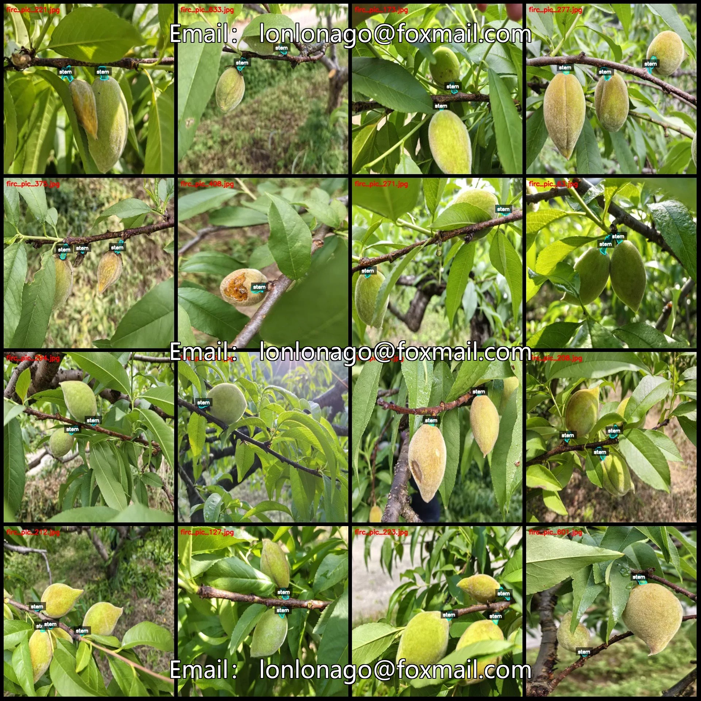
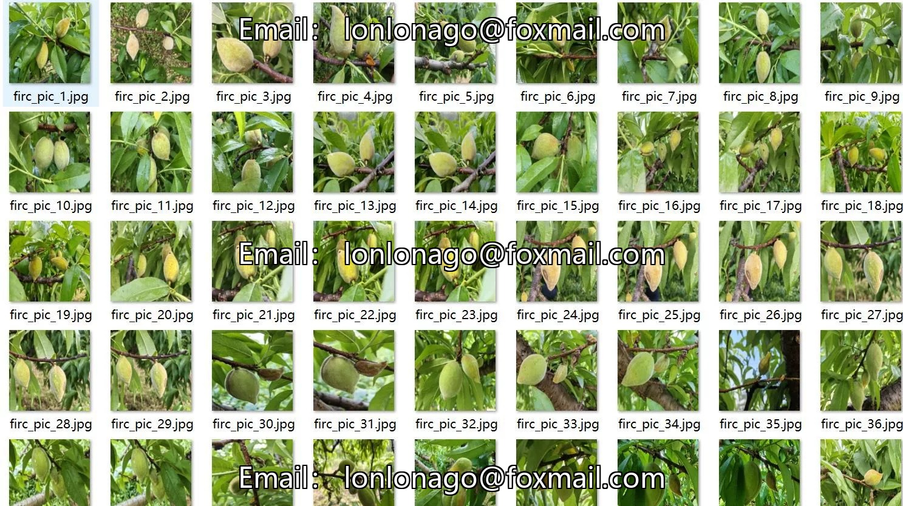
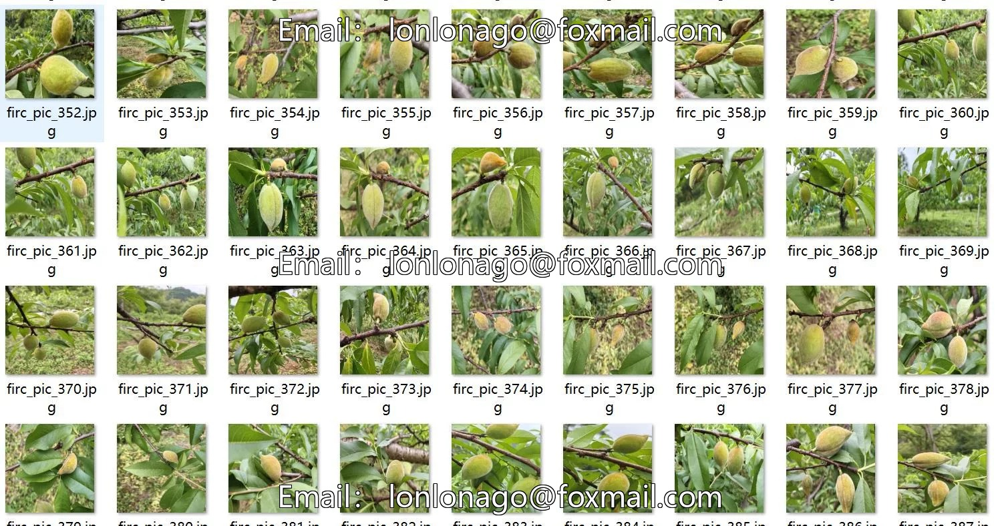
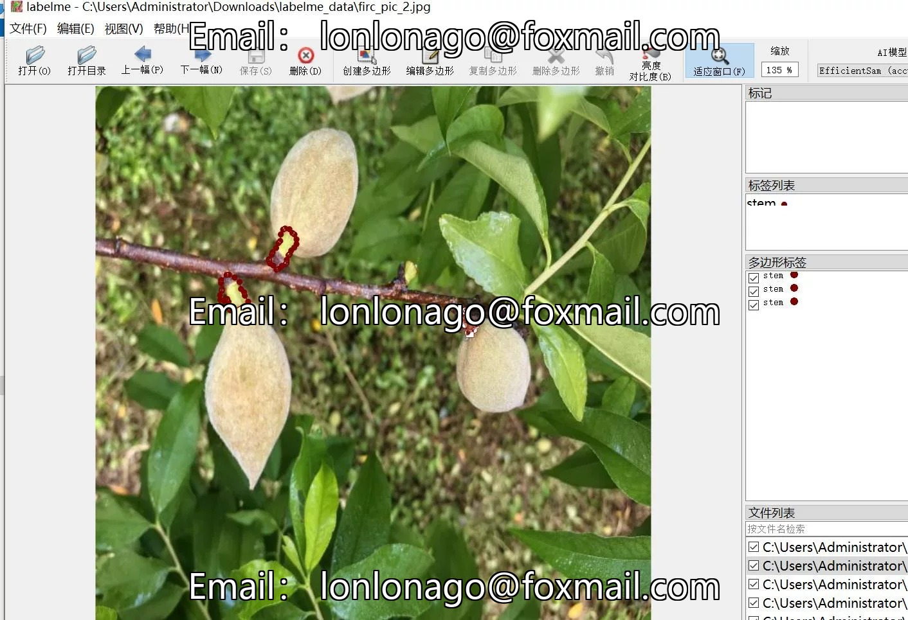
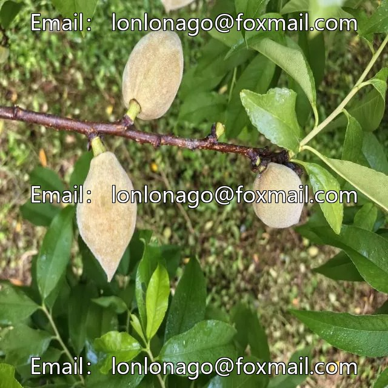
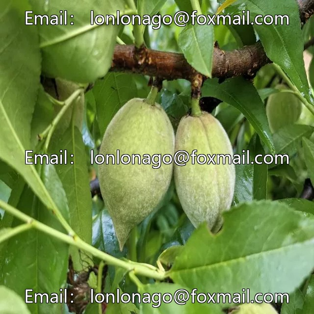
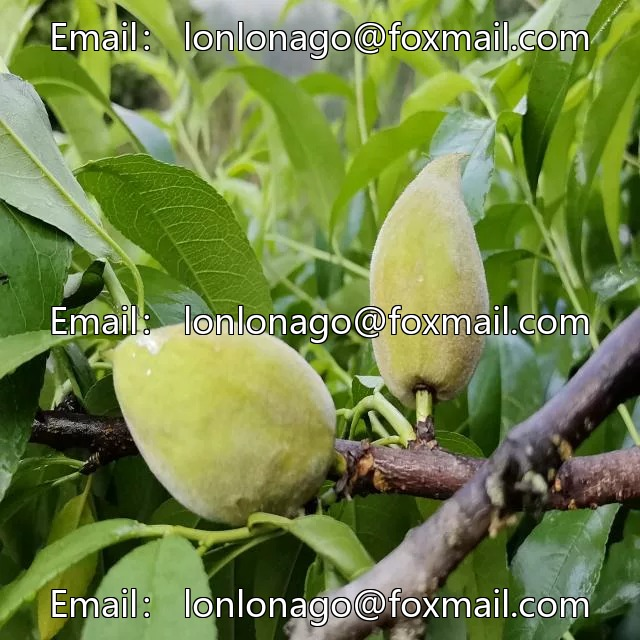

# Tree-based Peach Branch Segmentation Dataset - LabelMe format: 823 images, 1 category

## Body

The dataset consists of 823 images of yellow peaches with stems, labeled in the labelme format. It includes 1 category.

Please note: Since this dataset is reusable, please confirm that it meets your requirements before purchasing.

The dataset is in labelme format (excluding the mask file, only including jpg images and corresponding json files).

Number of images (number of jpg files): 823
Number of annotations (number of json files): 823
Number of categories: 1
Category names: ["stem"]

Each category has an annotation box count and image count as follows:
- Stem boxes = 1843, image count = 823
- Total boxes = 1843

Annotation tool used: labelme = 5.5.0
Image resolution: 640x640

Annotation rules: Polygons are drawn around the categories.
Important note: The dataset can be opened and edited using LabelMe, and for JSON datasets, they need to be converted into mask or Yolo format or Coco format for semantic segmentation or instance segmentation.
Special notice: This dataset does not guarantee any accuracy in the trained models or weight files.

## Images

## Payment

Here is a pay link on Stripe ( https://buy.stripe.com/3cs8yP7sY87d0vu9AB ). Please contact me lonlonago@foxmail.com after funding $89, and I will send you a complete data files , thank you!

